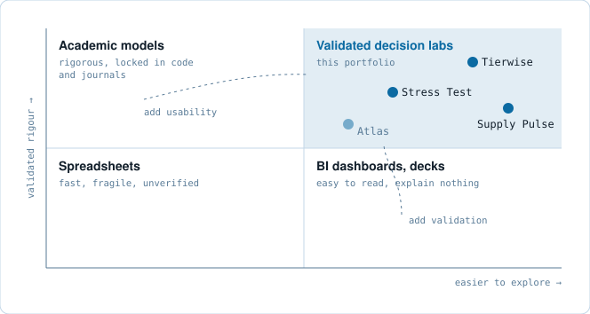
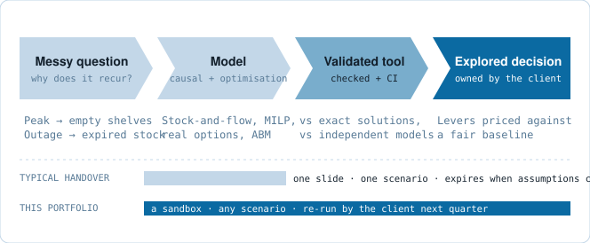
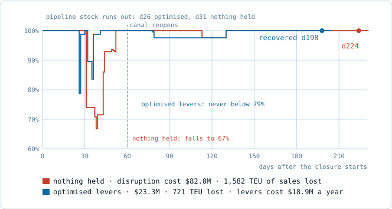
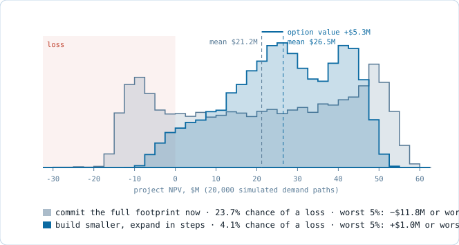
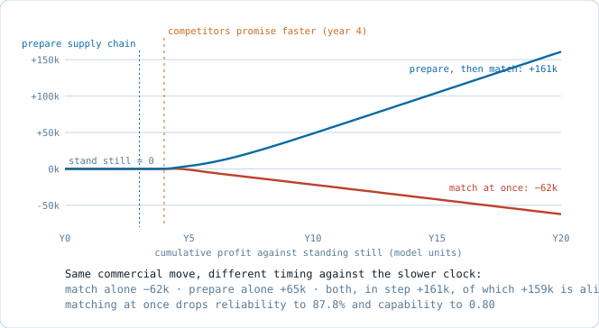

<picture>
  <source media="(prefers-color-scheme: light)" srcset="assets/banner-light.png?v=5">
  
</picture>

**Research and open decision tools for supply network design, disruption and flexibility.**
Every model here runs in the browser, is tested in CI, and is free to use and inspect.

## Rigour you can actually use

Most supply chain analysis is either rigorous and locked in code and journals, or easy to read and impossible to check. These tools aim at the corner in between: models validated against independent references, built so a decision can be explored rather than read off a slide.

<picture>
  <source media="(prefers-color-scheme: dark)" srcset="assets/doors/positioning-dark.svg">
  
</picture>

<picture>
  <source media="(prefers-color-scheme: dark)" srcset="assets/doors/how-i-work-dark.svg">
  
</picture>

## Three ways in

Pick the question closest to yours. Each starts with a tool you can open on a phone in two minutes, then one you can load with your own assumptions.

### 1. How long can your network survive a closure, and what does recovering faster cost?

<picture>
  <source media="(prefers-color-scheme: dark)" srcset="assets/doors/door-survive-dark.svg">
  
</picture>

On the Atlas sample network, closing the Red Sea for 60 days costs **$82.0M** with nothing held. The lever set the optimiser recommends costs **$18.9M a year**, cuts this event to **$23.3M**, and cuts expected annual loss from **$50.4M to $15.1M**. It does that with contracts, standby capacity and air, not stock, so the first shortfall comes five days *sooner*.

**Try it:** [Global Disruption Atlas](https://kathuman.github.io/estay-dynamics/atlas/) · pick a historical closure and compare time-to-survive with time-to-recover. 
**Test your own network:** [Network Stress Test](https://kathuman.github.io/claude-projects/network-stress-test/web/) · load nodes and lanes, run the N-1 scan and find the single point of failure. 
**Leads to:** a resilience diagnostic on your own network, with each lever priced.

### 2. What is it worth to stage, wait or lease instead of committing on one forecast?

<picture>
  <source media="(prefers-color-scheme: dark)" srcset="assets/doors/door-flexibility-dark.svg">
  
</picture>

In the default case, building smaller and expanding in steps is worth **$5.3M more** than committing the full footprint now, and cuts the chance of losing money from **24% to 4%**. Over 20,000 simulated demand paths, the means match the lattice valuation within $0.3M.

**Try it:** [Real Options for Network Design](https://kathuman.github.io/claude-projects/real-options/) · five strategies against the best fixed design, with the demand levels that trigger the next step. 
**Test your own case:** [Tierwise](https://kathuman.github.io/claude-projects/tierwise/) · load a multi-tier chain from CSV or Excel and see which site runs out of capacity first, and when. 
**Leads to:** an option valuation of one capacity decision you have on the table.

### 3. Why does a commercial move this quarter cost money a year later?

<picture>
  <source media="(prefers-color-scheme: dark)" srcset="assets/doors/door-clocks-dark.svg">
  
</picture>

When competitors promise faster delivery, matching them at once **loses money** against standing still. Preparing the supply chain a year earlier and then matching **gains 161k**: preparing alone is worth 65k, and 159k comes from moving the two clocks in step.

**Try it:** [Lag Lab](https://kathuman.github.io/claude-projects/lag-lab/) · after a demand step, how much of the overshoot is really forecast error? 
**Test your own policy:** [Supply Pulse](https://kathuman.github.io/supply-pulse/) · overtime, faster quality release or a new planning policy, each against a fair baseline. 
**Then fly it:** [Clockspeed Balancing](https://kathuman.github.io/claude-projects/clockspeed/) · 20 years of commercial, supply chain and network decisions, and a debrief of which clock made or cost the money. 
**Leads to:** a workshop where your team flies its own strategy and sees its own debrief.

Every figure above is a run of the tool's own engine on its built-in example: the Atlas sample company is fictional (real ports and lanes), the Real Options case is its default, and Clockspeed is in model units. The methods transfer; the numbers are yours to replace.

## Checked before it is used

      

Each model is tested against something independent of itself: the flow solver against optimality certificates and a second max-flow algorithm, the option lattice against Black–Scholes, delays against their exact solutions, the Atlas against the PortWatch record. The suites run on every change.

**Also in the lab:** [Robot Configurator](https://kathuman.github.io/claude-projects/robot-configurator/), [AI Expectations Gap Map](https://kathuman.github.io/claude-projects/ai-expectations-gap-map/), [Warehouse Model](https://kathuman.github.io/claude-projects/warehouse-model/web/), [Tube Flow](https://kathuman.github.io/claude-projects/tube-flow-sim/), [Cobot Lab](https://kathuman.github.io/claude-projects/cobot-lab/) and more on the [projects site](https://kathuman.github.io/claude-projects/).

---

PhD, Technical University of Denmark · MSc, MIT · Council member, System Dynamics Society · Published in the *Journal of Simulation*, the NATO Science Series and *Computers & Security* · Past sector experience in mining, beverage distribution, healthcare and pharmaceutical manufacturing · Copenhagen

Questions, bugs or ideas about a tool are welcome as [issues](https://github.com/kathuman/claude-projects/issues).

[Technical depth](https://kathuman.github.io/estay-dynamics/technical-depth.html): validation and test suites, research, the full tool portfolio and the lab.
