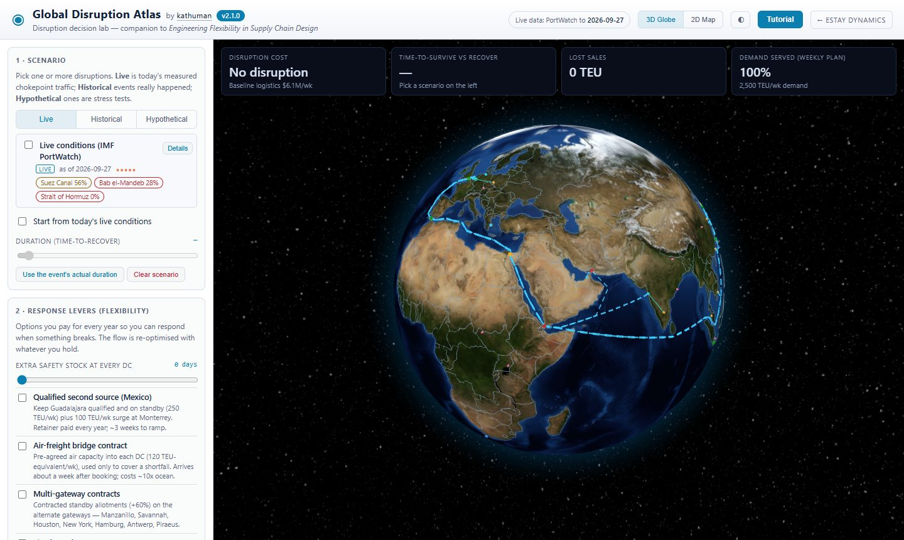
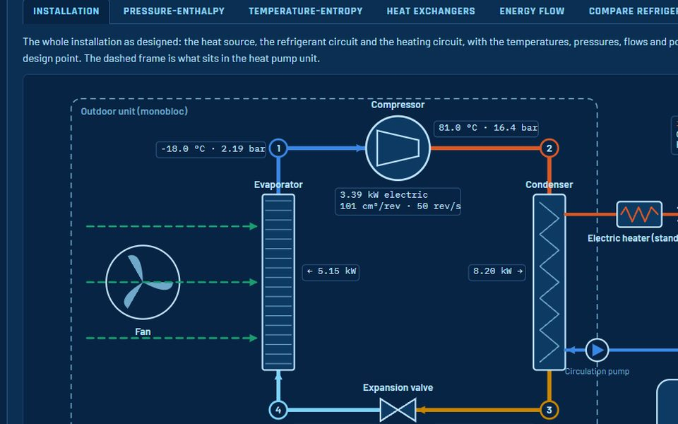
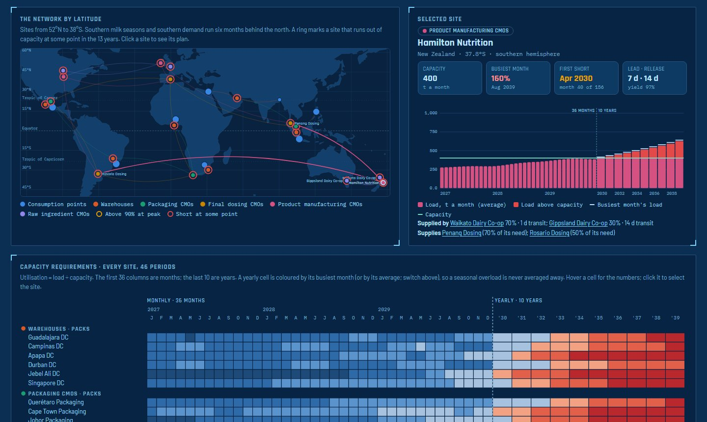
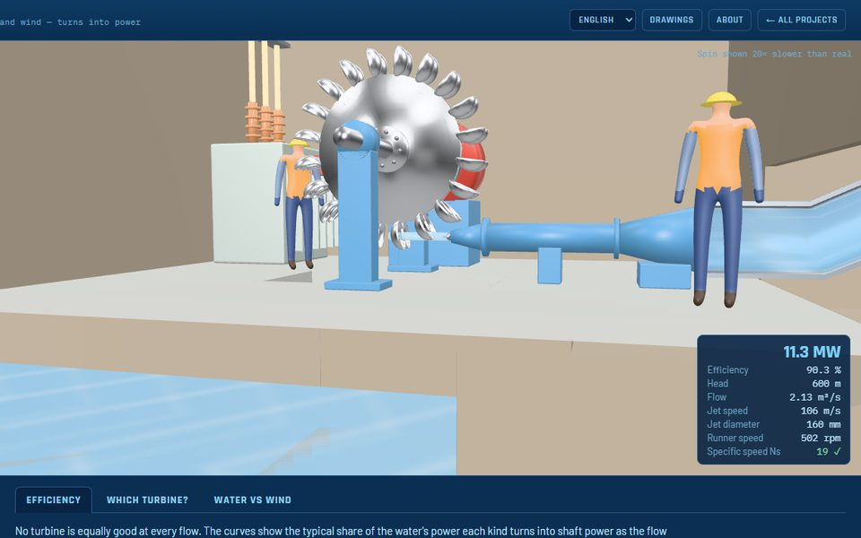
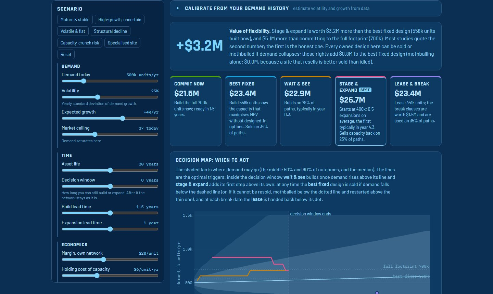
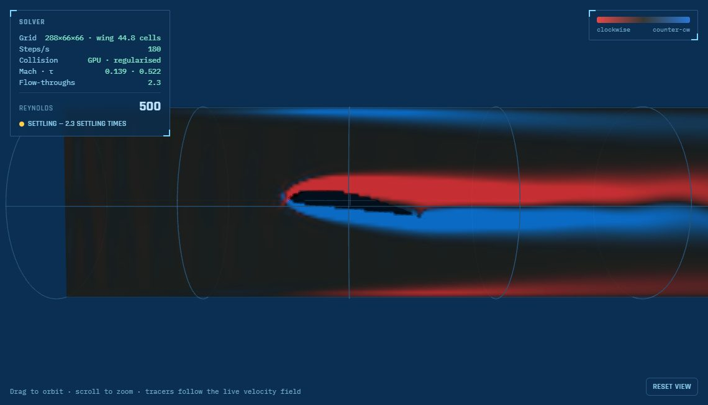
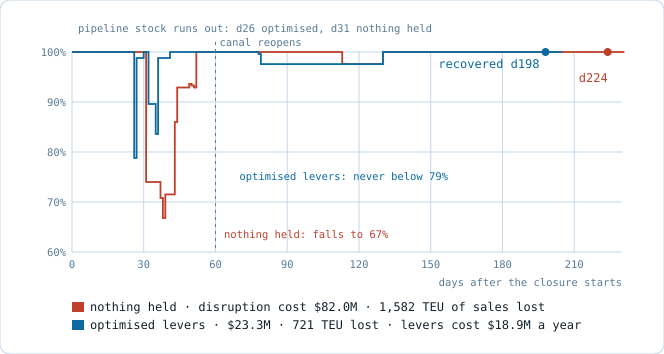
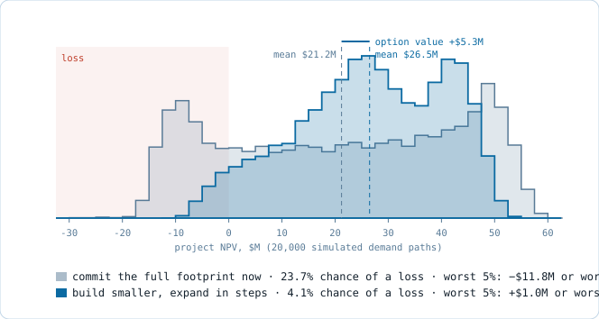
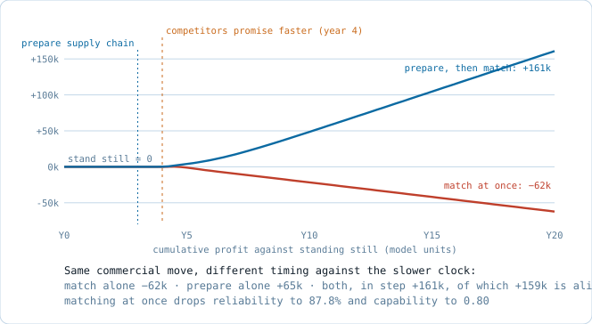

<picture>
  <source media="(prefers-color-scheme: light)" srcset="assets/banner-light.png?v=7">
  
</picture>

**Engineering and supply chain tools that run in the browser.** Each one is tested in CI, free to use, and open to inspect.

## About

- **Mechanical engineer by training.** Civil Mechanical Engineer, Universidad Técnica Federico Santa María (Chile), and Dipl.-Ing. in Mechanical Engineering, DHBW Mosbach (Germany): thermodynamics, turbomachines, heat transfer, CFD and finite elements.
- **Supply chain researcher.** MSc in Industrial Engineering, Pontificia Universidad Católica de Chile; SM in Management Science, MIT; PhD in Operations Management, Technical University of Denmark (DTU), including a year as a visiting researcher at the MIT Center for Transportation & Logistics.
- **Across industries.** Mining, fast-moving consumer goods (FMCG) and beverage distribution, industrial manufacturing, healthcare, and pharmaceutical manufacturing. Council member of the System Dynamics Society. Based in Copenhagen.

## Two disciplines, one way of working

<!-- GALLERY:START -->
<table>
  <tr><th width="50%">Supply chain</th><th width="50%">Mechanical engineering</th></tr>
  <tr><td width="50%"> <a href="https://kathuman.github.io/estay-dynamics/atlas/"><strong>Global Disruption Atlas</strong></a> How long a network survives a closure, and what recovering faster costs.</td><td width="50%"> <a href="https://kathuman.github.io/claude-projects/heat-pump-studio/"><strong>Heat Pump Studio</strong></a> Design a heat pump from the building's heat loss to the compressor.</td></tr>
  <tr><td width="50%"> <a href="https://kathuman.github.io/claude-projects/tierwise/"><strong>Tierwise</strong></a> Plan capacity across a multi-tier supply chain, with every number proved by the solver.</td><td width="50%"> <a href="https://kathuman.github.io/claude-projects/turbine-lab/"><strong>Turbine Lab</strong></a> Pelton, Francis and Kaplan turbines in 3D, with the physics behind them.</td></tr>
  <tr><td width="50%"> <a href="https://kathuman.github.io/claude-projects/real-options/"><strong>Real Options for Network Design</strong></a> What staging, waiting or leasing is worth against one big commitment.</td><td width="50%"> <a href="https://kathuman.github.io/claude-projects/tube-flow-sim/"><strong>Tube Flow</strong></a> Lattice-Boltzmann CFD of flow past a sphere in a tube, validated against theory.</td></tr>
  <tr><td width="50%"> <a href="https://kathuman.github.io/claude-projects/Beer-Distribution-Game/"><strong>Ripple</strong></a> A supply chain ordering game for classes, with Claude as an optional player.</td><td width="50%">In the lab: <a href="https://kathuman.github.io/claude-projects/robot-configurator/">Robot Configurator</a>, <a href="https://kathuman.github.io/claude-projects/balancebot-sim/">Plumb</a>, <a href="https://kathuman.github.io/claude-projects/cobot-lab/">Cobot Lab</a>, <a href="https://kathuman.github.io/claude-projects/rubiks-cube/">Cube Studio</a>. <a href="https://kathuman.github.io/claude-projects/?cat=mechanical"><strong>All mechanical engineering tools →</strong></a> (7)</td></tr>
  <tr><td colspan="2"><strong>Supply chain</strong>. In the lab: <a href="https://kathuman.github.io/supply-pulse/">Supply Pulse</a>, <a href="https://kathuman.github.io/claude-projects/clockspeed/">Clockspeed Balancing</a>, <a href="https://kathuman.github.io/claude-projects/lag-lab/">Lag Lab</a>, <a href="https://kathuman.github.io/claude-projects/network-stress-test/web/">Network Stress Test</a>. <a href="https://kathuman.github.io/claude-projects/?cat=supply-chain"><strong>All supply chain tools →</strong></a> (10)</td></tr>
</table>

**Also on the site:** [Epicycles](https://kathuman.github.io/claude-projects/epicycles/), [AI Expectations Gap Map](https://kathuman.github.io/claude-projects/ai-expectations-gap-map/), [Sensor Deck](https://kathuman.github.io/claude-projects/phone-sensors/), [Chess for Kids](https://kathuman.github.io/claude-projects/chess/kids/) and [more](https://kathuman.github.io/claude-projects/?cat=other).
<!-- GALLERY:END -->

## One result worth a look

<picture>
  <source media="(prefers-color-scheme: dark)" srcset="assets/doors/door-survive-dark.svg">
  
</picture>

On the Atlas sample network, closing the Red Sea for 60 days costs **$82.0M** with nothing held. The lever set the optimiser recommends costs **$18.9M a year**, cuts this event to **$23.3M**, and cuts the expected annual loss from **$50.4M to $15.1M**, with contracts, standby capacity and air rather than stock. [Try it in the Atlas](https://kathuman.github.io/estay-dynamics/atlas/).

<b>What is it worth to stage, wait or lease instead of committing on one forecast?</b>

 
<picture>
  <source media="(prefers-color-scheme: dark)" srcset="assets/doors/door-flexibility-dark.svg">
  
</picture>

In the default case, building smaller and expanding in steps is worth **$5.3M more** than committing the full footprint now, and cuts the chance of losing money from **24% to 4%**. Over 20,000 simulated demand paths, the means match the lattice valuation within $0.3M. [Real Options for Network Design](https://kathuman.github.io/claude-projects/real-options/).

<b>Why does a commercial move this quarter cost money a year later?</b>

 
<picture>
  <source media="(prefers-color-scheme: dark)" srcset="assets/doors/door-clocks-dark.svg">
  
</picture>

When competitors promise faster delivery, matching them at once **loses money** against standing still. Preparing the supply chain a year earlier and then matching **gains 161k**: preparing alone is worth 65k, and 159k comes from moving the two clocks in step. [Clockspeed Balancing](https://kathuman.github.io/claude-projects/clockspeed/).

## Checked before it is used

      

Each model is tested against something independent of itself: the flow solver against optimality certificates and a second max-flow algorithm, Tierwise's capacity plan against a duality receipt recomputed from the solver's prices, the option lattice against Black–Scholes, the refrigerant cycle against CoolProp, the CFD against Stokes' law, and the Atlas against the PortWatch record. The suites run on every change.

The figures above are runs of each tool's own engine on its built-in example: the Atlas sample company is fictional (real ports and lanes), the Real Options case is its default, and Clockspeed is in model units. The gallery is rebuilt daily from the projects list.
