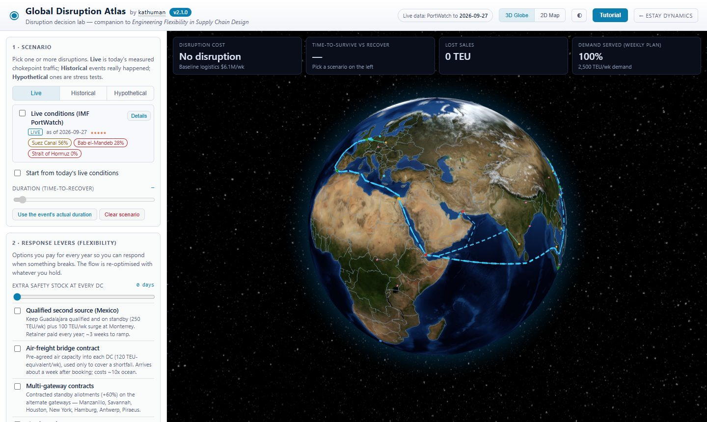
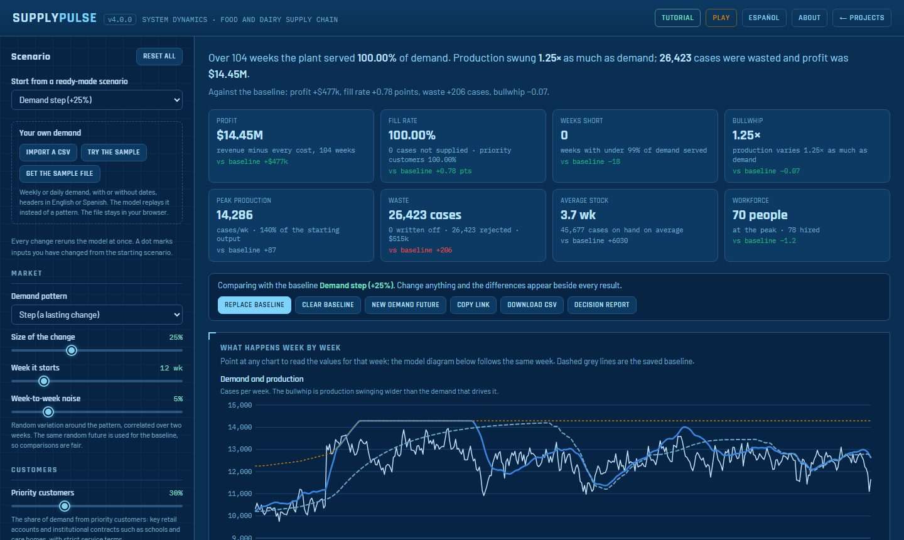
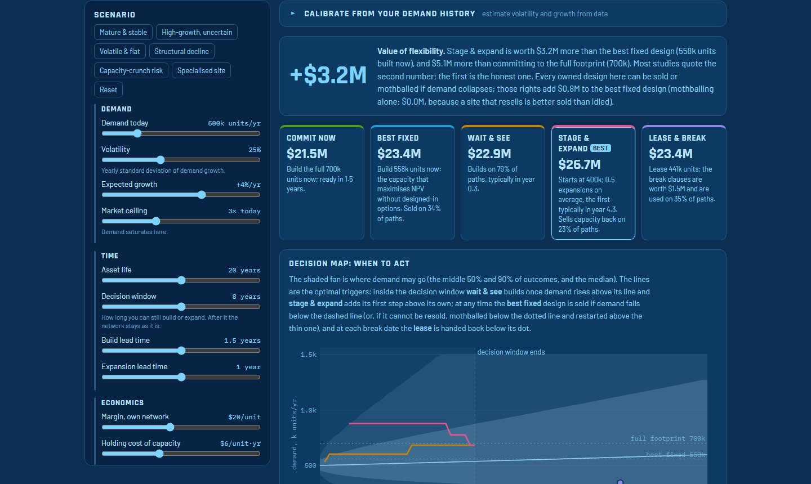
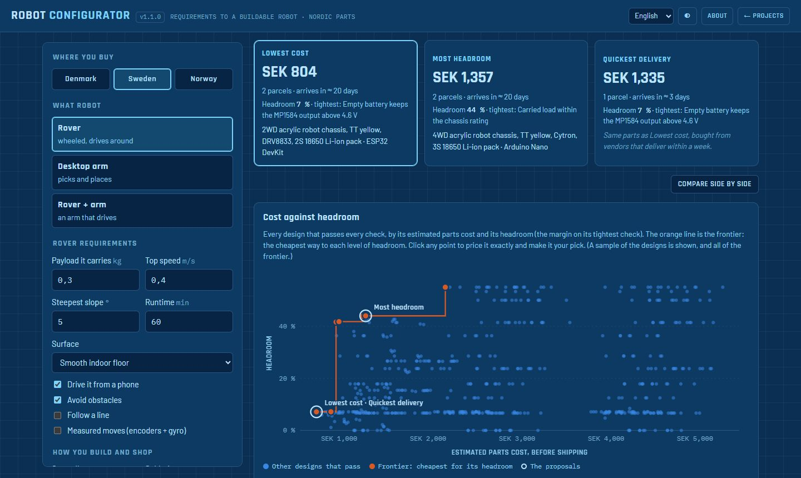
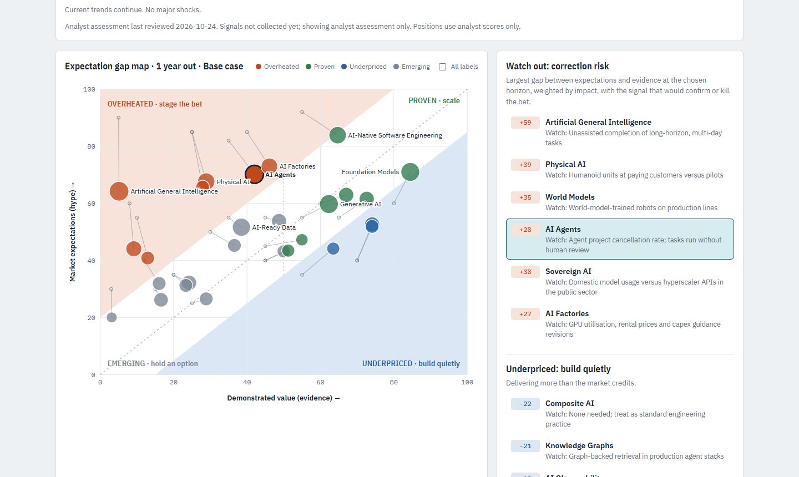

<picture>
  <source media="(prefers-color-scheme: light)" srcset="assets/banner-light.png?v=5">
  
</picture>

**Research and open decision tools for supply network design, disruption and flexibility.**
Every model here runs in the browser, is tested in CI, and is free to use and inspect.

## Questions these tools explore

| The question | What the models show | Try it |
|---|---|---|
| Why does the same supply problem come back every year? | Recurring problems come from feedback and delays, not bad luck. | [Supply Pulse](https://kathuman.github.io/supply-pulse/) · [Lag Lab](https://kathuman.github.io/claude-projects/lag-lab/) |
| Is overshoot after a demand step really forecast error? | Much of it is the structure of planning, not the forecast. | [Lag Lab](https://kathuman.github.io/claude-projects/lag-lab/) |
| Which disruption would really hurt a network? | Exposure is time-to-survive versus time-to-recover, not a risk-register score. | [Global Disruption Atlas](https://kathuman.github.io/estay-dynamics/atlas/) · [Network Stress Test](https://kathuman.github.io/claude-projects/network-stress-test/web/) |
| What is it worth to stage, defer or lease capacity instead of committing on one forecast? | Flexibility has a price you can calculate. | [Real Options for Network Design](https://kathuman.github.io/claude-projects/real-options/) |
| What happens when commercial, supply and network decisions move at different speeds? | Clockspeed mismatch is a design problem, not a coordination problem. | [Clockspeed Balancing](https://kathuman.github.io/claude-projects/clockspeed/) |

## Principles behind the models

- **Model the system before optimising it.** First find the loops and delays that produce the problem. Then decide what to change.
- **Test every decision against a fair baseline.** A response only counts if it beats what a competent team would have done anyway.
- **Value flexibility explicitly.** Buffers, second sources and staged capacity cost money every year. They should carry a value too.
- **Keep the model open.** Code, tests and assumptions are public, so anyone can rerun, check or extend them.

## See it working

<table>
<tr>
<td width="50%" valign="top">

<b><a href="https://kathuman.github.io/estay-dynamics/atlas/">Global Disruption Atlas</a></b> 
<i>If a strait or a major port closes, which sites run out first, and what does each response cost?</i> 
It compares each site's time-to-survive with its time-to-recover to show which buffers, second sources or air bridges pay off.
</td>
<td width="50%" valign="top">

<b><a href="https://kathuman.github.io/supply-pulse/">Supply Pulse</a></b> 
<i>Why does a demand peak or a plant stoppage turn into empty shelves, then written-off stock?</i> 
It tests whether overtime, faster quality release or a different planning policy actually pays, measured against a fair baseline.
</td>
</tr>
<tr>
<td width="50%" valign="top">

<b><a href="https://kathuman.github.io/claude-projects/tierwise/">Tierwise</a></b> 
<i>Which site in a multi-tier chain runs out of capacity first, and when must more be added?</i> 
It sizes the capacity to add, site by site and year by year, and shows how much demand is served if nothing is added.
</td>
<td width="50%" valign="top">

<b><a href="https://kathuman.github.io/claude-projects/real-options/">Real Options for Network Design</a></b> 
<i>Build full scale now, build smaller and expand, wait, or lease?</i> 
It puts a value on each option against the best fixed design, and gives the demand levels that should trigger the next decision.
</td>
</tr>
</table>

The examples run on illustrative data, mostly from food and dairy. The methods transfer to other sectors.

## Also in the lab

<table>
<tr>
<td width="50%" valign="top">

</td>
<td width="50%" valign="top">
<b><a href="https://kathuman.github.io/claude-projects/robot-configurator/">Robot Configurator</a></b> 
<i>Which rover or robot arm can I actually build from parts sold in Denmark, Sweden or Norway, and what will it cost delivered?</i> 
It checks every compatible combination of parts against torque, grip, current, voltage, runtime and pin limits, then prices the best with VAT, duty and shipping. A chart of cost against headroom shows what extra margin costs, and any part can be swapped to see which check it fails. Each design comes with a build guide, the wiring and Arduino programs that compile as delivered. In English, Danish, Swedish, Norwegian and Spanish.
</td>
</tr>
<tr>
<td width="50%" valign="top">

</td>
<td width="50%" valign="top">
<b><a href="https://kathuman.github.io/claude-projects/ai-expectations-gap-map/">AI Expectations Gap Map</a></b> 
<i>Where do expectations of AI run ahead of what it has delivered, and how would a different future change that?</i> 
It replaces the hype curve with two axes, market expectations and demonstrated value, for 27 AI technologies; the gap between them is the risk. Five drivers, from capital availability to enterprise data readiness, project the board forward, and each bet comes with the signal that would confirm or kill it. Public attention signals are collected every month and flag the scores they contradict for review.
</td>
</tr>
</table>

---

PhD, Technical University of Denmark · MSc, MIT · Council member, System Dynamics Society · Published in the *Journal of Simulation*, the NATO Science Series and *Computers & Security* · Past sector experience in mining, beverage distribution, healthcare and pharmaceutical manufacturing · Copenhagen

Questions, bugs or ideas about a tool are welcome as [issues](https://github.com/kathuman/claude-projects/issues).

[Technical depth](https://kathuman.github.io/estay-dynamics/technical-depth.html): validation and test suites, research, the full tool portfolio and the lab.
